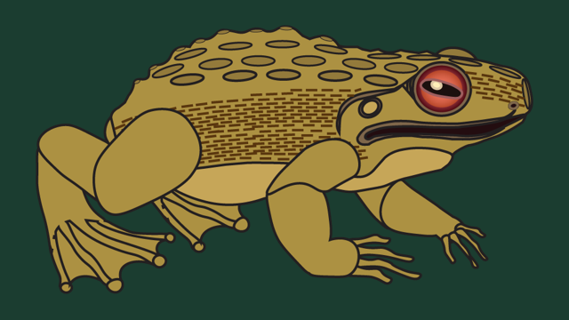

# Hungry Hopper



A side-scrolling swamp platformer made by the Kunzler family. You are a frog: hop between leaves, eat bugs with your tongue, stomp the rest, dodge briars and owls, and beat the Fly Boss at the end of each area. It runs on your device and works offline.

## Get it

| Where | What |
|-------|------|
| **[jwkunz.github.io/hungry_hopper](https://jwkunz.github.io/hungry_hopper/)** | The web game, always the latest `main` (deployed by GitHub Pages) |
| **[Actions](https://github.com/jwkunz/hungry_hopper/actions/workflows/ci.yml)** | Open the latest successful **CI** run and download the `hungry-hopper-apk` artifact (Android debug APK) or `hungry-hopper-html` (single self-contained file) |
| **[Releases](https://github.com/jwkunz/hungry_hopper/releases)** | `hungry-hopper-vX.Y.Z.html` and `hungry-hopper-vX.Y.Z-debug.apk`, published when a `v*` tag is pushed |

To install the APK, copy it to an Android phone or tablet and allow installs from your file manager or browser. It is a debug build, so Android may warn about it.

## Game features

Keyboard, touch buttons and the Android app all play the same game. The full guide is in [docs/gameplay.md](docs/gameplay.md).

- **Controls:** walk, jump (hold for height), and shoot a tongue you can aim up or down, on the ground or in mid-air. On-screen buttons appear for touch.
- **One hit kills,** unless you hold a firefly shield. Stomp enemies or eat them. You have 3 lives and respawn at checkpoint flags.
- **Five areas:** Marsh, Bog, Cypress Forest, Night Storm and the Hive, each with its own look, weather and boss. Finish one to unlock the next.
- **Bestiary:** mosquitos, bats that shriek, owls, moles, beetles, centipedes, pill bugs and cranes, each with its own trick.
- **Tongue tricks:** grapple to vines, pull a log across a pit as a bridge, burn briars with a pepper, glide with a dragonfly, light dark areas with a glow bug, and chain kills into combos.
- **Secrets:** golden flies hide in every level; find them all for stars on the level-select screen.
- **Settings:** music and effects volume, mute, on-screen buttons and a low-power graphics mode (it also switches on by itself on slow devices). Progress and best scores are saved on the device.

## Repository layout

```
VERSION                  the one place the project version lives
web/                     the game (React + Vite, plain-JavaScript game core)
  src/game/                engine, entities, levels, rendering, audio (no React in here)
  src/components/          React: canvas, touch controls, menus
  src/assets/              sprites and audio
  scripts/build-single.mjs builds the one-file HTML distributable
  test/                    node:test unit tests
Android/                 Gradle project: a WebView app that bundles the web build
scripts/version.mjs      keeps VERSION, web/package.json and its lock file in step
tools/                   asset scripts (mosquito atlas, audio conversion)
docs/                    gameplay guide and build notes per version
PLAN.md                  game vision, mechanics and milestone roadmap
.github/workflows/       ci.yml (tests, builds, APK, releases) and pages.yml (site deploy)
```

The web game is edited in exactly one place, `web/`. Both the GitHub Pages site and the Android app are built from it, so a push to `main` updates the site, and the next APK build picks up the same code.

## How it fits together

1. `npm run build` in `web/` runs Vite with `vite-plugin-singlefile`, which inlines all JavaScript, CSS, sprites and audio into one HTML file, `web/dist/hungry_hopper-vX.Y.Z.html` (git-ignored).
2. That file is:
   - copied to the site as `index.html` by `pages.yml`,
   - bundled by Gradle into the Android app as `assets/index.html`, which `MainActivity` loads in a full-screen landscape WebView,
   - attached to each GitHub release.

React owns the canvas and the animation loop; the game itself is plain JavaScript classes in `web/src/game/`. It draws in a fixed 960×540 view scaled to fit any screen.

## Building locally

**Web.** Needs Node.js 20 or newer.

```bash
cd web
npm install
npm run dev      # dev server with hot reload (http://localhost:5173)
npm test         # unit tests
npm run build    # builds web/dist/hungry_hopper-vX.Y.Z.html; open it in a browser
```

Add `?debug` to the URL to see hitboxes.

**Android.** Needs JDK 21, the Android SDK, and the web prerequisites above.

```bash
cd Android
./gradlew :app:assembleDebug        # builds the web page first, then the APK
adb install -r app/build/outputs/apk/debug/app-debug.apk
```

Pass `-PskipWebBuild` to reuse an existing `web/dist/hungry_hopper-v*.html`. The APK is a debug build; a Play Store upload would need a signed release build, which is not set up here.

## Continuous integration

- **`ci.yml`** runs on pushes to `main`, tags and pull requests: checks the version files agree, runs the unit tests, builds the single HTML file (and verifies it has no external references), and builds the debug APK. Both files are uploaded as run artifacts.
- **On a `v*` tag** it also publishes a GitHub release containing the HTML file and the APK.
- **`pages.yml`** runs the tests, builds the single HTML file and deploys it to GitHub Pages on every push to `main`.

## Versioning and releasing

```bash
node scripts/version.mjs                # print the version
node scripts/version.mjs set 3.1.0      # update VERSION, web/package.json, web/package-lock.json
node scripts/version.mjs check          # fail if they disagree
```

Add notes under `docs/build_notes/`, then commit and tag:

```bash
git tag v3.1.0 && git push origin v3.1.0
```

CI refuses to release if the tag doesn't match `VERSION`. The Android `versionName` and `versionCode` (`major*10000 + minor*100 + patch`) are derived from `VERSION`. The in-game version text comes from `web/package.json`.

## Privacy

The game has no ads, analytics, accounts or network access. Scores, progress and settings stay in local storage on your device.
